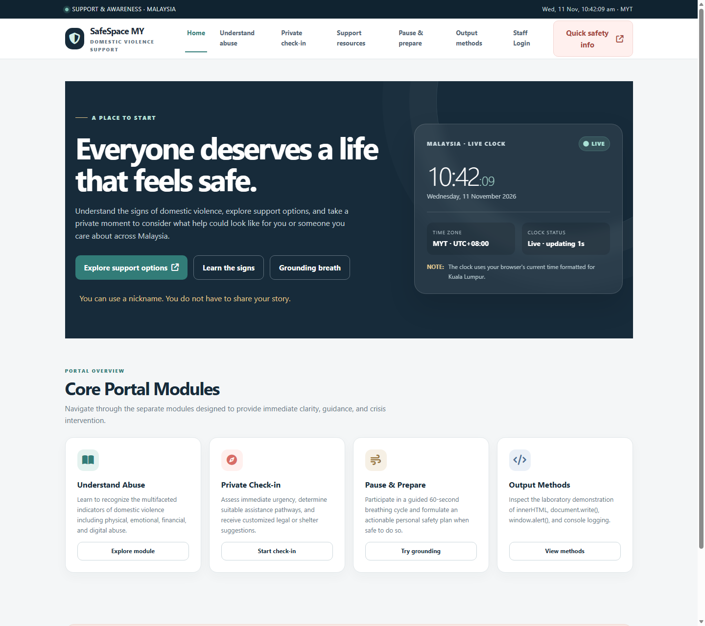

# SafeSpace MY · ITT588 Lab Work 03

**Live Online Deployment (Cloudflare Workers):** [https://itt588-safespace-my.ammarsyaathir.workers.dev](https://itt588-safespace-my.ammarsyaathir.workers.dev)

**Faculty of Computer & Mathematical Sciences (FSKM), Universiti Teknologi MARA (UiTM)**  
**Course Code:** ITT588 – Front-End Technology  
**Title:** Client-Side Scripting and Dynamic Output Methods for a Domestic Violence Support Web Application in Malaysia  
**Student Name:** Muhammad Ammar Syaathir Bin Abd Rahim  
**Student ID:** 2025179251  
**Group:** CS2666B  
**Lecturer:** Sir Shahadan Saad  

---

## 1. Main Page Preview & Explanation



The main page (`/` or `/home`) combines the global master layout ([`views/layouts/main.html`](views/layouts/main.html)) with the Home dashboard view ([`views/pages/home.html`](views/pages/home.html)) to present a calm, accessible entry point for domestic violence awareness and support in Malaysia:

1. **Top Announcement Bar & Live Mini Clock (`.topline`)**  
   Displays the `SUPPORT & AWARENESS · MALAYSIA` status indicator on the left and a live Malaysian Standard Time mini clock (`#clockMini`) on the right, synchronized every 1,000 ms using `Intl.DateTimeFormat` for the `Asia/Kuala_Lumpur` timezone in [`public/js/clock.js`](public/js/clock.js).
2. **Primary Navigation Header (`<header>`)**  
   Features the **SafeSpace MY** brand shield, seven route links (`Home`, `Understand abuse`, `Private check-in`, `Support resources`, `Pause & prepare`, `Output methods`, and `Staff Login`) with active-tab highlighting injected by the controller, and a **Quick safety info** (`#quickHelp`) button that immediately opens an urgent safety modal with emergency numbers (`999` and `Talian Kasih 15999`) via [`public/js/modal.js`](public/js/modal.js).
3. **Hero Section (`#home`)**  
   Highlights the core message (*"Everyone deserves a life that feels safe."*) alongside three primary call-to-action buttons:
   - **Explore support options** (`/checkin`) — launches the private urgency check-in form.
   - **Learn the signs** (`/learn`) — opens educational material on forms of abuse.
   - **Grounding breath** (`/calm`) — opens the 60-second breathing exercise and safety checklist.
   A privacy note underneath reassures visitors that they can use a nickname and do not have to share personal details.
4. **Malaysia Live Timepiece Card (`.time-card`)**  
   Positioned on the right side of the hero grid, this live dashboard widget renders 24-hour `HH:MM:SS` digits (`#clockHours`, `#clockMinutes`, `#clockSeconds`), the full local date (`#clockDate`), `MYT · UTC+08:00` timezone metadata, and a live `Live · updating 1s` status indicator powered by `setInterval`.
5. **Core Portal Modules (`.awareness`)**  
   A four-card overview section giving direct access to the portal's key features: **Understand Abuse** (`/learn`), **Private Check-in** (`/checkin`), **Pause & Prepare** (`/calm`), and **Output Methods** (`/methods`).
6. **Bottom Safety Callout & Emergency Footer**  
   Below the main content, a reassurance banner (`#safetyReminder`) opens an interactive safety reminder modal, while the footer provides clickable `tel:999` and `tel:15999` (Talian Kasih) emergency links.

---

## 2. Project Architecture (Separation of Concerns)

This project implements a **Model-View-Controller (MVC)** web application with separated **Router**, **Controllers**, **Views**, **CSS**, **Client-Side Scripts**, and a **Cloudflare Worker** edge adapter so it runs both locally on Node.js/Express and online on Cloudflare Workers:

```text
LAB 03/
├── config/
│   └── routes.js             <-- ROUTER: Central Express HTTP routing table
├── controllers/
│   ├── pageController.js     <-- CONTROLLER: View rendering & page data dispatcher
│   ├── supportController.js  <-- CONTROLLER: Check-in processing & risk evaluation
│   └── authController.js     <-- CONTROLLER: Reads Password.txt & authenticates sessions
├── views/
│   ├── layouts/
│   │   └── main.html         <-- VIEW LAYOUT: Global master template (Nav, Clock, Modal, Foot)
│   └── pages/
│       ├── home.html         <-- VIEW PAGE 1: Home dashboard & live Malaysia timepiece
│       ├── learn.html        <-- VIEW PAGE 2: Understand the 4 forms of abuse
│       ├── checkin.html      <-- VIEW PAGE 3: Interactive support check-in HTML form
│       ├── resources.html    <-- VIEW PAGE 4: Emergency hotlines & support contacts
│       ├── calm.html         <-- VIEW PAGE 5: 60-second breathing orb & safety checklist
│       ├── methods.html      <-- VIEW PAGE 6: 4 JavaScript output methods showcase
│       └── login.html        <-- VIEW PAGE 7: Staff login form verifying Password.txt
├── public/
│   ├── css/
│   │   └── style.css         <-- CSS: Dedicated responsive design system & print styles
│   └── js/
│       ├── clock.js          <-- JS MODULE: Live MYT clock (1s interval, Intl API)
│       ├── modal.js          <-- JS MODULE: Accessible modal dialog & escape handler
│       ├── breathing.js      <-- JS MODULE: Grounding breathing orb (async/await event loop)
│       ├── outputMethods.js  <-- JS MODULE: The 4 required output methods implementation
│       ├── checkin.js        <-- JS MODULE: Client-side form handler & risk categorization
│       └── router.js         <-- JS MODULE: Client-side SPA router for standalone browser mode
├── src/
│   └── worker.js             <-- CLOUDFLARE WORKER: Edge router & API adapter
├── docs/
│   └── main-page.png         <-- SCREENSHOT: Captured render of the live main page
├── Password.txt              <-- FILE HANDLING: Credentials file for authentication
├── server.js                 <-- SERVER ENTRY: Express full-stack web application
├── wrangler.jsonc            <-- CLOUDFLARE CONFIG: Workers & static assets deployment config
├── package.json              <-- NPM CONFIG: Dependencies & run scripts
├── index.html                <-- STANDALONE ENTRY: Allows direct double-click browser viewing
└── README.md                 <-- Complete documentation & lab rubric mapping
```

---

## 3. Activity & Grading Rubric Verification

| Lab 3 Requirement | Implementation Location | Description |
| :--- | :--- | :--- |
| **Separate Pages** | `views/pages/*.html` | Individual templates for Home, Learn, Check-in, Resources, Calm, Methods, and Login. |
| **Router** | `config/routes.js` / `src/worker.js` | Express & Worker routing tables mapping HTTP paths to Controller actions (`GET`, `POST`). |
| **Controllers** | `controllers/*.js` | Business logic separated into `pageController`, `supportController`, and `authController`. |
| **Separated CSS** | `public/css/style.css` | Modular CSS design tokens, grid/flexbox layouts, responsive breakpoints, and print styles. |
| **HTML Form** | `views/pages/checkin.html` | Input validation, text fields, radio urgency selectors, category dropdowns, and textarea notes. |
| **PopUp Dialog** | `public/js/modal.js` | Custom accessible modal layer with backdrop blur, focus management, Escape key listener, and ARIA tags. |
| **Output Method 1:** `innerHTML` | `public/js/checkin.js` | Dynamically renders tailored evaluation cards into `#modalContent` without page reloads. |
| **Output Method 2:** `document.write()` | `public/js/outputMethods.js` | Opens a separate window and writes an isolated, print-optimized Emergency Support Summary document. |
| **Output Method 3:** `window.alert()` | `public/js/outputMethods.js` | Centered safety notification dialog with fallback to accessible modal alert. |
| **Output Method 4:** `console` | `public/js/outputMethods.js` | Dispatches structured `console.table()` logs to browser DevTools and mirrors onto the on-page terminal. |
| **Date & Time Handling** | `public/js/clock.js` | Synchronizes Malaysian Standard Time (`Asia/Kuala_Lumpur`) every 1,000 ms using `Intl.DateTimeFormat`. |
| **Event Loop & Operators** | `public/js/breathing.js` | Utilizes `async/await`, Promises, `setTimeout`, switch/case control statements, and cancellation tokens. |
| **Password.txt Auth** | `controllers/authController.js` | Reads `Password.txt`, parses `user,pass,role`, and authenticates staff login requests. |

---

## 4. How to Run & Deploy

### Option A: Live Online Deployment (Cloudflare Workers)
Visit the deployed application directly at:  
[https://itt588-safespace-my.ammarsyaathir.workers.dev](https://itt588-safespace-my.ammarsyaathir.workers.dev)

To redeploy updates to Cloudflare Workers:
```powershell
npx wrangler deploy
```

### Option B: Running Locally with Node.js & Express
1. Install dependencies:
   ```powershell
   npm install
   ```
2. Start the server:
   ```powershell
   npm start
   ```
3. Open `http://localhost:3000` in your browser.

### Option C: Direct Browser Viewing (Standalone Mode)
Double-click `index.html` in File Explorer. The client-side router (`public/js/router.js`) displays each view and provides full interactive functionality without a running server.

---

## 5. Test Accounts for `Password.txt` Authentication

The `/login` route authenticates credentials against `Password.txt`:
* **Username:** `sir` | **Password:** `secret` *(Role: moderator)*
* **Username:** `admin` | **Password:** `admin123` *(Role: administrator)*
* **Username:** `user1` | **Password:** `user123` *(Role: user)*
